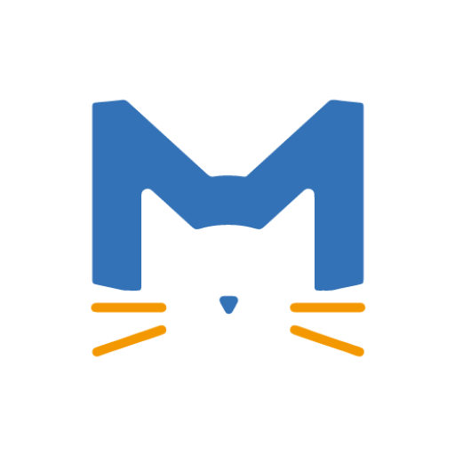
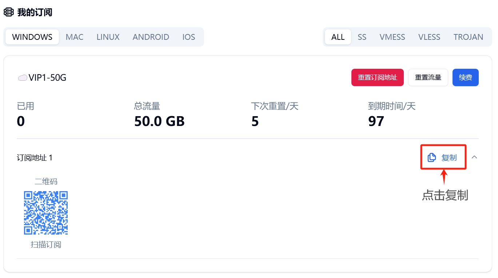
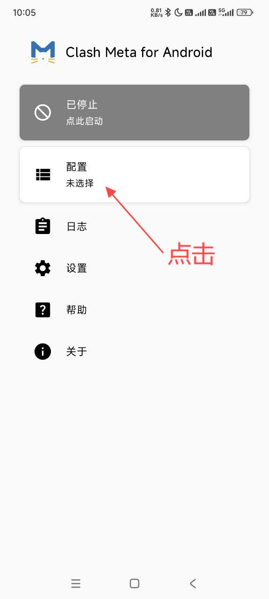
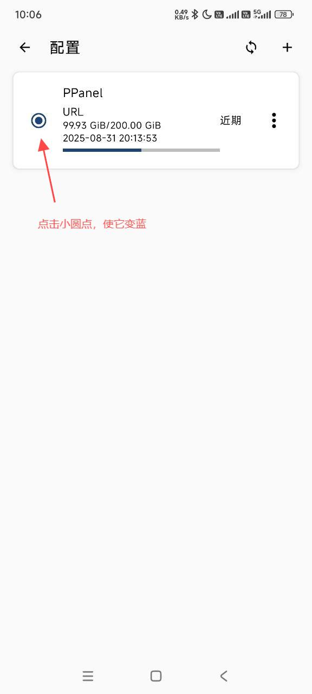

# Clash Meta for Android (CMFA)

> Clash Meta for Android is a graphical Clash.Meta client for Android. It is not the discontinued legacy Clash for Android (CFA); this guide covers the actively maintained CMFA project.

## Step 0: Install the app

Both links below download the same package: Clash Meta for Android v2.11.32 for ARM64 devices.

| Download source | Link |
|---|---|
| Fast mirror | [Download Android APK](https://dl.onsucloud.com/https://github.com/MetaCubeX/ClashMetaForAndroid/releases/download/v2.11.32/cmfa-2.11.32-meta-arm64-v8a-release.apk) |
| Official GitHub download | [Download Android APK](https://github.com/MetaCubeX/ClashMetaForAndroid/releases/download/v2.11.32/cmfa-2.11.32-meta-arm64-v8a-release.apk) |

> This package is for `arm64-v8a` devices, including most recent Android phones and tablets.

The official package name is `com.github.metacubex.clash.meta`. Android may ask you to allow your browser or file manager to install unknown apps.

## Step 1: Copy the subscription URL

Sign in to the customer portal, open My Subscriptions, select Android, and click Copy next to the subscription URL.

> Do not share this URL. It normally contains credentials for your account.

## Step 2: Open Profiles

Open Clash Meta for Android and tap `Profiles` on the home screen.

## Step 3: Create a profile

Tap the `+` button in the upper-right corner.

Select `URL` to import a remote profile.

## Step 4: Paste the subscription URL

Enter a recognizable name, paste the subscription URL in the URL field, and tap the save button in the upper-right corner.

## Step 5: Activate the profile

Return to the profile list and select the profile you just added. A selected indicator on its left means the profile is active.

If the nodes do not update, tap the refresh button in the upper-right corner. If refreshing fails, check that the subscription is active and that the complete URL was pasted.

## Step 6: Connect

Return to the home screen and tap the top card showing `Stopped`. On the first connection, Android displays a VPN connection request; tap Allow or OK.

The card turns blue and shows `Running`. A VPN icon also appears in the Android status bar.

## Choose a server

To switch servers manually, tap `Proxy` on the home screen, open the relevant policy group, and select a server. Lower latency usually means a faster response on the current network. A failed latency test does not always mean the server is unusable, so you can switch to it and test a website directly.

## Troubleshooting

### No servers appear after import

- Refresh the profile and wait for the update to finish.
- Make sure you copied a Clash or universal subscription URL, not the plan purchase page.
- Copy the complete URL again in a browser; messaging apps can truncate long links.

### The app says Running, but websites do not load

- Open Proxy and switch to another server.
- Temporarily disable other VPNs, ad blockers, or Private DNS.
- Stop the service, start it again, and accept the Android VPN request.

### Update the subscription

Open Profiles and tap the refresh button in the upper-right corner. Refresh after changing plans or whenever the server list changes.

### Why not use the legacy Clash for Android?

The legacy Clash for Android is no longer maintained. Use Clash Meta for Android and download it only from the official GitHub repository or F-Droid to avoid unofficial repackaged APKs.

---

Last verified: October 23, 2026

Supported client: Clash Meta for Android 2.11.x
