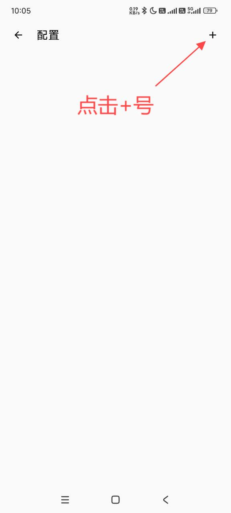
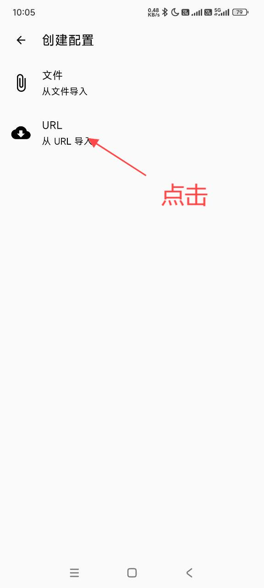
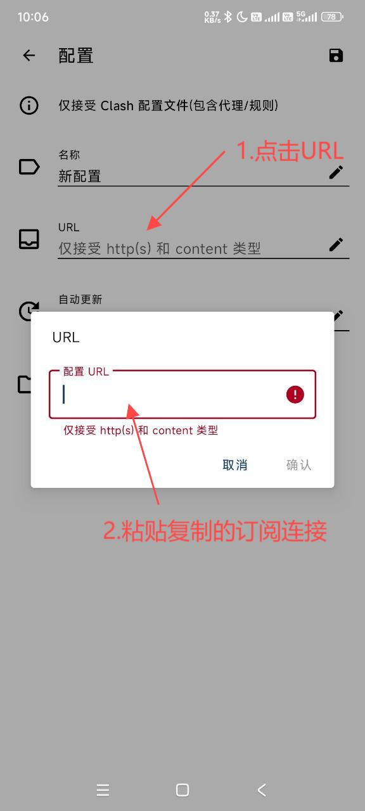
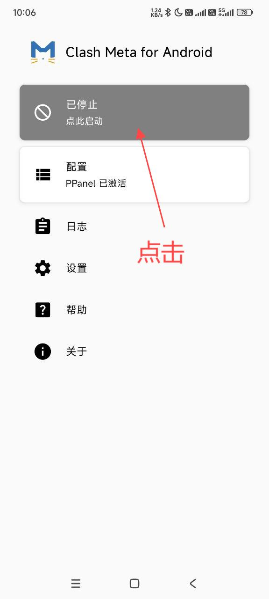
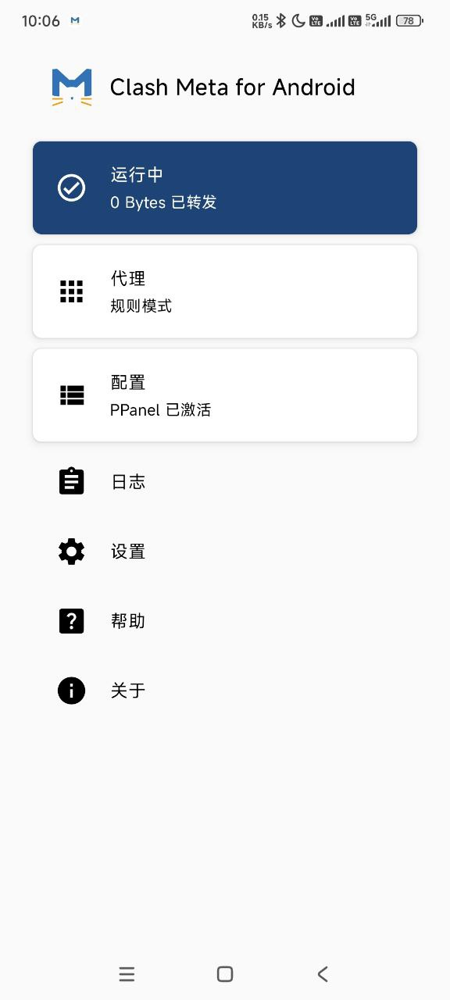

# Clash Meta for Android（CMFA）

> Clash Meta for Android 是 Android 上的 Clash.Meta 图形客户端。它与已经停止维护的旧版 Clash for Android（CFA）不是同一个项目；本教程使用目前仍在更新的 CMFA。

## 第 0 步：安装 App

下面两个地址下载的是同一个安装包：Clash Meta for Android v2.11.32（ARM64）。

| 下载方式 | 下载链接 |
|---|---|
| 镜像快速下载 | [下载 Android APK](https://dl.onsucloud.com/https://github.com/MetaCubeX/ClashMetaForAndroid/releases/download/v2.11.32/cmfa-2.11.32-meta-arm64-v8a-release.apk) |
| GitHub 官方下载 | [下载 Android APK](https://github.com/MetaCubeX/ClashMetaForAndroid/releases/download/v2.11.32/cmfa-2.11.32-meta-arm64-v8a-release.apk) |

> 该安装包适用于 `arm64-v8a` 设备，包括大多数近年的 Android 手机和平板。

官方应用包名为 `com.github.metacubex.clash.meta`。安装 APK 时，Android 可能要求允许浏览器或文件管理器“安装未知应用”。

## 第 1 步：复制订阅链接

登录用户中心，在“我的订阅”中切换到 Android，然后点击订阅地址旁的“复制”。

> 请勿把订阅链接发送给他人。链接通常包含你的账户凭据。

## 第 2 步：打开配置页面

打开 Clash Meta for Android，在主页点击“配置”。

## 第 3 步：新建配置

点击右上角的 `+`。

选择“URL（从 URL 导入）”。

## 第 4 步：粘贴订阅链接

名称可以填写容易识别的内容。在 URL 一栏粘贴刚才复制的订阅链接，然后点击右上角的保存按钮。

## 第 5 步：启用配置

返回配置列表，点选刚刚添加的配置。配置左侧出现选中标记后，说明已经启用。

如果节点没有更新，可以点击右上角的刷新按钮。更新失败时，请先检查订阅是否过期，以及订阅链接是否完整。

## 第 6 步：启动连接

回到首页，点击顶部显示“已停止”的卡片。首次连接时，Android 会弹出 VPN 连接请求，请选择“允许”或“确定”。

卡片变成蓝色并显示“运行中”，同时系统状态栏出现 VPN 图标，即表示连接已经启动。

## 选择节点

需要手动切换节点时，点击首页的“代理”，进入对应策略组后选择节点。节点右侧显示的延迟越低，通常代表当前网络下的响应越快；延迟测试失败不一定代表节点完全不可用，可以直接切换后再尝试访问网页。

## 常见问题

### 导入后没有节点

- 下拉或点击刷新，重新更新配置。
- 确认复制的是 Clash/通用订阅链接，而不是套餐购买页面的网址。
- 在浏览器中重新复制完整链接，避免聊天软件截断链接。

### 显示“运行中”但无法上网

- 进入“代理”切换其他节点。
- 暂时关闭其他 VPN、广告过滤器或私人 DNS 后重试。
- 停止服务，再重新启动并允许系统 VPN 请求。

### 如何更新订阅

进入“配置”，点击右上角的刷新按钮。更换套餐后、节点发生变化时，建议手动更新一次。

### 为什么不推荐旧版 Clash for Android

旧版 Clash for Android 已停止维护。请使用本教程中的 Clash Meta for Android，并始终从官方 GitHub 或 F-Droid 下载，避免安装来源不明的改包。

---

最后核对：2026 年 10 月 23 日

适用客户端：Clash Meta for Android 2.11.x
